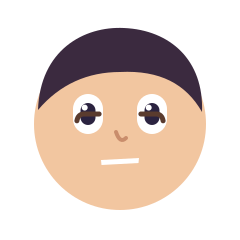

<div align="center">

# live-face-svg

**Give any drawn character a living face that blinks, glances, smiles and talks, as one SVG that plays anywhere.**

The live face from [rossark-motion-skill](https://github.com/rossark0/rossark-motion-skill) without React Native, Reanimated or SwiftUI. Drop the output in a README, an `` tag or a landing page.

Works with **Claude Code** and **Codex**.

 

  

<sub>These are the real files written by `node live-face-svg.mjs --all docs/`. They move on GitHub: SVG with SMIL animation.</sub>

</div>

## Quick start
```bash
git clone https://github.com/Dodai0419/live-face-svg && cd live-face-svg
node live-face-svg.mjs --mood happy -o face.svg
```
```
face.svg  62879 bytes, 7000 ms loop
```
Open `face.svg` in a browser, or put `` anywhere. Node 18+, no `npm install`.

## Gallery
Every mood from the feelings table of rossark-motion-skill, rendered with `node live-face-svg.mjs --all docs/`:

| happy | talking | tired | sad |
|---|---|---|---|
|  |  |  |  |
| glances aside, blinks twice, one smiling squint | 12 syllables of ~180 ms, head sway | lids rest at 0.35, one slow heavy blink | looks down and away, one slow look up |

| focused | sleepless | wink | robot (your own art) |
|---|---|---|---|
|  |  |  |  |
| small saccades, one rare blink | wide eyes at the ceiling, then the clock, then a tired close | one eye closes, cheek lifts | `--face examples/robot.json --mood talking` |

A still frame for reduced motion or a thumbnail (`--at 5200`, the middle of the smile):


## The problem
- The live-face templates in rossark-motion-skill need a React Native app (react-native-svg + Reanimated) or a SwiftUI project, so you cannot use them on a web page, a README or a slide.
- A GIF of a face is heavy, blurry when scaled and cannot be edited after it is made.
- Hand-writing SVG `<animate>` tags for blinks and glances means guessing timings, and the loop usually jumps when it repeats.

## The solution
| Idea | Fixes |
|------|-------|
| **Same engine, sampled into SMIL** | `track()` and `flow()` from motion.ts, with the same curves (ease-in-out `0.77, 0, 0.175, 1`, ease-out `0.23, 1, 0.32, 1`), are sampled per frame into `<animate values>`. The browser plays it; no JavaScript runs. |
| **Same face rig** | Pupil and shine slide clipped to the white, lid and cheek are skin clipped to a pill 2 units larger than the white, a closed-eye line and happy arc fade in at the end of the move, the mouth deepens and the tongue follows. |
| **Moods as data** | Seven choreographies built from the method's feelings table. Each loop's last key equals its first, so it never jumps. Pass your own with `--choreo`. |
| **Vector output** | Sharp at any size and easy to restyle: change `ink` colours in the face JSON and render again. |

## Use your own character
Make a face JSON (copy `examples/robot.json`): `art` is the SVG under the eyes, `front` is what covers the lids (a nose, glasses), `eyes` and `mouth` say where the live parts sit, `pivot` is the neck the head tilts around.
```bash
node live-face-svg.mjs --face examples/robot.json --mood wink -o robot-wink.svg
```
Write your own loop as JSON, in the same shape as the moods in `live-face-svg.mjs`:
```json
{ "period": 6000,
  "lookX": [[0, 0], [1500, 0], [2000, 5], [3500, 5], [4000, 0], [6000, 0]],
  "lookY": [[0, 0], [6000, 0]],
  "lid":   [[0, 0], [2900, 0], [3010, 1], [3050, 1], [3240, 0, "out"], [6000, 0]] }
```
```bash
node live-face-svg.mjs --choreo my-loop.json -o mine.svg
```

## Use with Claude Code
```bash
/plugin marketplace add Dodai0419/live-face-svg
/plugin install live-face-svg@live-face-svg
```
Then ask: "give the mascot in `logo.svg` a living face that looks happy" or "make a talking avatar SVG for the README".

## Use with Codex (ChatGPT)
```bash
git clone https://github.com/Dodai0419/live-face-svg && cp -r live-face-svg/skills/* ~/.codex/skills/
```
Or copy `AGENTS.md` to your project root.

## Benchmarks
Windows 11, Node 24.20. Upstream: rossark0/rossark-motion-skill at commit 9b20964.

| | rossark-motion-skill (React Native template) | live-face-svg |
|-|-|-|
| lines for engine + live face | 373 (`motion.ts` 157 + `liveFace.tsx` 216) | 166 (engine 74 + face 92); the whole file with 7 moods and the CLI is 283 |
| runtime dependencies | 4 (react, react-native, react-native-svg, react-native-reanimated) | 0 |
| where it runs | inside a React Native app | any browser, ``, GitHub README; no JS at view time |
| render one 7 s face at 60 fps | not measured (needs an app on a device or simulator) | 23-67 ms in a warm process (3 runs of 50) |
| CLI cold start, all 7 moods | not measured | 743-795 ms (3 runs) |

Commands: `wc -l` on the files above; `node -e` loop over `face(DEFAULT_FACE, MOODS.happy, {fps: 60})`; `node live-face-svg.mjs --all out/` timed with `date +%s%N`.

The engine was checked against a brute-force cubic-bezier solve (max error below 1e-5 over 101 points, `npm test`). The template's output was not run side by side, because it needs a mobile app.

## Inspired by
- [rossark0/rossark-motion-skill](https://github.com/rossark0/rossark-motion-skill): the motion engine, the live-face rig and the feelings table (MIT).

## Roadmap
- [ ] Breathing and follow-through layers (hair, ears) from section 5 of the method.
- [ ] `--png-frames` for video editors.
- [ ] Read eye and mouth positions from ids in an existing SVG (`#eye-left`, `#mouth`).

## License
MIT. See `LICENSE` and `NOTICE`.
